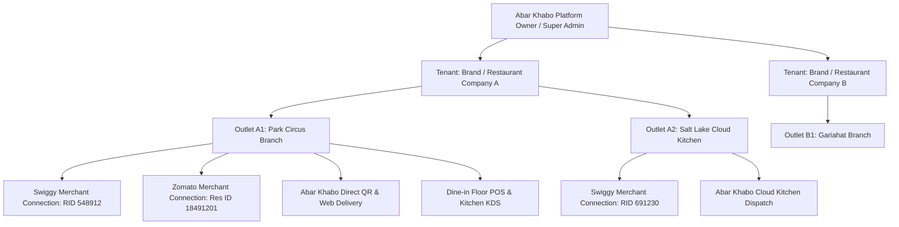
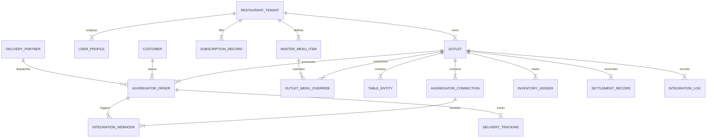

# STAGE 2: DATABASE SCHEMA & OUTLETS MODEL
## Multi-Tenant SaaS Architecture & Aggregator Integration Schema

**Project:** Abar Khabo  
**System:** Commercial Restaurant POS & Multi-Aggregator SaaS Engine  
**Document Status:** Stage 2 Part A — Architecture & Schema Design (Pre-Implementation)  
**Date:** 2026-11-15  

---

## 1. EXECUTIVE OVERVIEW & ARCHITECTURAL MODEL

Abar Khabo is designed to scale from a single standalone food business to a national multi-brand, multi-outlet restaurant franchise while centralizing orders from **Swiggy**, **Zomato**, and **Abar Khabo Direct Ordering**.

### The Core SaaS Hierarchy



### Key Separation of Concerns
1. **Tenant (Restaurant Brand / Corporate Entity):**
   * Owns master brand identity, legal registrations (Company PAN, Corporate GSTIN), Central FSSAI, subscription billing, and the master menu catalog.
   * Super Admins and Brand Owners operate at this tier.
2. **Outlet (Physical Store / Branch / Cloud Kitchen):**
   * Owns geographical location (coordinates, street address), local FSSAI branch license, operating hours, delivery radius, dine-in tables, and kitchen display terminals.
   * **Crucial Rule:** Aggregators (Swiggy / Zomato) are registered and bound at the **Outlet level**, because each physical outlet has its own distinct Swiggy Restaurant ID (RID) and Zomato Restaurant ID (Res ID).
3. **Staff (Employees / Users):**
   * Staff members are provisioned under a Tenant and assigned to one or more specific Outlets with role-based permissions (`restaurant_admin`, `outlet_manager`, `cashier`, `kitchen`, `waiter`).

---

## 2. ENTITY RELATIONSHIP DIAGRAM (ERD)



---

## 3. FIRESTORE COLLECTION & SUBCOLLECTION SPECIFICATION

### Tier 1: Tenant & Organization Collections

#### 1. `restaurants/{restaurantId}`
Top-level corporate tenant document representing the restaurant brand.
* **Path:** `restaurants/{restaurantId}`
* **Document ID:** URL-safe slug or alphanumeric ID (e.g. `arsalan-group`, `spice-haven`)
* **Data Ownership:** Owned by platform Super Admin; managed by `restaurant_admin` / `owner`.

```json
{
  "id": "spice-haven",
  "name": "Spice Haven",
  "legalName": "Spice Haven Hospitality Pvt Ltd",
  "gstin": "19AAAAA0000A1Z5",
  "pan": "AAAAA0000A",
  "fssaiCentral": "10019031000000",
  "logoUrl": "https://images.unsplash.com/photo-1517248135467-4c7edcad34c4",
  "bannerUrl": "https://images.unsplash.com/photo-1555396273-367ea4eb4db5",
  "ownerEmail": "owner@restopulse.com",
  "contactPhone": "+919876543210",
  "subscriptionTier": "PRO",
  "subscriptionStatus": "ACTIVE",
  "features": ["pos", "kds", "swiggy", "zomato", "direct_ordering", "inventory", "thermal_printer"],
  "defaultCurrency": "INR",
  "timezone": "Asia/Kolkata",
  "status": "active",
  "createdAt": "2026-09-20T18:13:01Z",
  "updatedAt": "2026-11-15T01:50:00Z"
}
```

---

### Tier 2: Outlet-Level Collections

#### 2. `restaurants/{restaurantId}/outlets/{outletId}`
Physical branch, cloud kitchen, or franchise location.
* **Path:** `restaurants/{restaurantId}/outlets/{outletId}`
* **Document ID:** Outlet slug (e.g. `park-circus`, `salt-lake`, or default `spice-haven_main`)

```json
{
  "id": "spice-haven_main",
  "restaurantId": "spice-haven",
  "name": "Spice Haven - Main Branch",
  "outletCode": "SH-01",
  "outletType": "DINE_IN_AND_DELIVERY",
  "fssaiNumber": "22819012000123",
  "address": {
    "street": "12A Park Street, 2nd Floor",
    "area": "Park Circus",
    "city": "Kolkata",
    "state": "West Bengal",
    "postalCode": "700016",
    "landmark": "Near Mullick Bazar Crossing"
  },
  "coordinates": {
    "lat": 22.5497,
    "lng": 88.3639
  },
  "phone": "+919876543210",
  "email": "parkcircus@spicehaven.com",
  "isOnline": true,
  "isAcceptingOrders": true,
  "operatingHours": [
    { "day": "MONDAY", "open": "11:00", "close": "23:00", "isOpen": true },
    { "day": "TUESDAY", "open": "11:00", "close": "23:00", "isOpen": true },
    { "day": "WEDNESDAY", "open": "11:00", "close": "23:00", "isOpen": true },
    { "day": "THURSDAY", "open": "11:00", "close": "23:00", "isOpen": true },
    { "day": "FRIDAY", "open": "11:00", "close": "23:59", "isOpen": true },
    { "day": "SATURDAY", "open": "11:00", "close": "23:59", "isOpen": true },
    { "day": "SUNDAY", "open": "11:00", "close": "23:59", "isOpen": true }
  ],
  "deliveryRadiusKm": 12,
  "minOrderAmount": 150,
  "averagePrepTimeMinutes": 25,
  "packagingCharges": {
    "type": "ITEM",
    "orderLevelAmount": 0,
    "itemLevelAmount": 15
  },
  "taxes": [
    { "name": "CGST", "rate": 2.5 },
    { "name": "SGST", "rate": 2.5 }
  ],
  "status": "ACTIVE",
  "createdAt": "2026-11-15T01:50:00Z",
  "updatedAt": "2026-11-15T01:50:00Z"
}
```

---

### Tier 3: Aggregator Connection Specification

#### 3. `restaurants/{restaurantId}/outlets/{outletId}/aggregatorConnections/{aggregatorId}`
Stores Swiggy, Zomato, and middleware API credentials for each specific outlet.
* **Path:** `restaurants/{restaurantId}/outlets/{outletId}/aggregatorConnections/{aggregatorId}`
* **Document IDs:** `swiggy`, `zomato`, `urbanpiper`
* **Security:** **Never public**. Readable and writable only by `restaurant_admin` and `super_admin`.

```json
{
  "id": "swiggy",
  "restaurantId": "spice-haven",
  "outletId": "spice-haven_main",
  "aggregator": "SWIGGY",
  "merchantStoreId": "548912",
  "authType": "API_KEY",
  "encryptedCredentials": {
    "clientId": "swiggy_client_sh01",
    "encryptedSecret": "enc_v1_d89f81a7b8e...",
    "keyVersion": "2026-1"
  },
  "webhookSecret": "whsec_swiggy_sha256_spicehaven_2026",
  "connectionStatus": "CONNECTED",
  "storeStatusOnAggregator": "ONLINE",
  "autoAcceptOrders": false,
  "priceTierMultiplier": 1.15,
  "menuSyncEnabled": true,
  "inventorySyncEnabled": true,
  "lastSyncAt": "2026-11-15T01:45:00Z",
  "lastHeartbeatAt": "2026-11-15T01:49:12Z",
  "createdAt": "2026-11-15T01:50:00Z",
  "updatedAt": "2026-11-15T01:50:00Z"
}
```

---

### Tier 4: Master Menu & Outlet-Specific Overrides

#### 4. `restaurants/{restaurantId}/menuCatalog/{itemId}` (Master Brand Menu)
Master dish definitions across all branches.

```json
{
  "id": "dish_biryani_special",
  "restaurantId": "spice-haven",
  "name": "Awadhi Mutton Biryani Special",
  "shortCode": "AW-MUT-01",
  "description": "Fragrant long-grain basmati rice slow-cooked with tender mutton shank, saffron, and whole spices.",
  "categoryId": "cat_biryani",
  "categoryName": "Biryani & Rice",
  "foodType": "NON_VEG",
  "basePrice": 480,
  "taxRate": 5.0,
  "imageUrl": "https://images.unsplash.com/photo-1563379091339-03b21ab4a4f8",
  "tags": ["Chef Special", "Bestseller"],
  "variants": [
    { "id": "var_regular", "name": "Regular (1 pc Mutton + 1 Egg + 1 Alu)", "price": 480 },
    { "id": "var_special", "name": "Special (2 pcs Mutton + 1 Egg + 1 Alu)", "price": 620 }
  ],
  "addonGroups": [
    {
      "id": "addon_gravy",
      "name": "Extra Gravy & Salan",
      "min": 0,
      "max": 2,
      "items": [
        { "id": "salan_01", "name": "Mirchi Ka Salan", "price": 40 },
        { "id": "raita_01", "name": "Burhani Garlic Raita", "price": 50 }
      ]
    }
  ],
  "isAlcohol": false,
  "createdAt": "2026-09-20T18:13:01Z",
  "updatedAt": "2026-11-15T01:50:00Z"
}
```

#### 5. `restaurants/{restaurantId}/outlets/{outletId}/menuOverrides/{itemId}` (Branch Inventory & Price Overrides)
Outlet-level dynamic availability and aggregator pricing.

```json
{
  "id": "dish_biryani_special",
  "outletId": "spice-haven_main",
  "restaurantId": "spice-haven",
  "isAvailable": true,
  "outOfStockReason": null,
  "nextAvailableAt": null,
  "priceOverrideDineIn": null,
  "priceOverrideDirect": 480,
  "priceOverrideSwiggy": 550,
  "priceOverrideZomato": 550,
  "stockQuantity": 35,
  "turnaroundTimeMins": 20,
  "updatedAt": "2026-11-15T01:50:00Z"
}
```

---

### Tier 5: Unified Aggregated Orders Model

#### 6. `aggregatorOrders/{orderId}` (Unified Multi-Channel Orders)
The heart of the Petpooja-grade aggregation system. Normalized across **Swiggy**, **Zomato**, **Direct Online Ordering**, and **Dine-in POS**.
* **Path:** `aggregatorOrders/{orderId}`
* **Document ID:** Unique composite or UUID (e.g. `ORD_SW_1598218902`, `ORD_ZM_98124`, `ORD_DIR_a8f90b`)

```json
{
  "id": "ORD_SW_1598218902",
  "restaurantId": "spice-haven",
  "outletId": "spice-haven_main",
  "orderSource": "SWIGGY",
  "aggregatorOrderId": "1598218902",
  "channelDisplayId": "SW-8902",
  "orderType": "DELIVERY",
  "orderStatus": "PREPARING",
  "cookingStatus": "COOKING",
  "customer": {
    "name": "Priyanka Sen",
    "phone": "+919830098300",
    "isMaskedNumber": true,
    "deliveryAddress": {
      "formatted": "Flat 4B, South City Towers, Prince Anwar Shah Road, Kolkata 700068",
      "lat": 22.5023,
      "lng": 88.3614
    }
  },
  "items": [
    {
      "itemId": "dish_biryani_special",
      "name": "Awadhi Mutton Biryani Special",
      "variantName": "Special (2 pcs Mutton)",
      "quantity": 2,
      "unitPrice": 550,
      "totalPrice": 1100,
      "foodType": "NON_VEG",
      "addons": [
        { "id": "raita_01", "name": "Burhani Garlic Raita", "price": 50, "quantity": 2 }
      ],
      "cookingNotes": "Please keep spices medium, no excess oil"
    }
  ],
  "pricing": {
    "itemTotal": 1200,
    "taxes": 60,
    "packagingCharge": 30,
    "deliveryFee": 0,
    "restaurantDiscount": 100,
    "aggregatorDiscount": 50,
    "grandTotal": 1140,
    "commissionRate": 18.0,
    "commissionAmount": 216,
    "netPayout": 924
  },
  "payment": {
    "method": "SWIGGY_PAY",
    "status": "PAID",
    "transactionId": "TXN_SW_891240182"
  },
  "delivery": {
    "deliveryBy": "SWIGGY_FLEET",
    "riderName": "Suman Das",
    "riderPhone": "+919874512345",
    "riderPhoto": "https://img.swiggy.com/riders/suman.jpg",
    "riderCoordinates": { "lat": 22.5480, "lng": 88.3630 },
    "pickupOtp": "4819"
  },
  "timestamps": {
    "placedAt": "2026-11-15T01:30:10Z",
    "acceptedAt": "2026-11-15T01:31:05Z",
    "cookingStartedAt": "2026-11-15T01:31:40Z",
    "foodReadyAt": null,
    "dispatchedAt": null,
    "deliveredAt": null,
    "cancelledAt": null
  },
  "idempotencyKey": "swiggy_order_1598218902_v1",
  "createdAt": "2026-11-15T01:30:10Z",
  "updatedAt": "2026-11-15T01:31:40Z"
}
```

---

### Tier 6: Infrastructure & Integration Collections

#### 7. `integrationWebhooks/{webhookId}` (Raw Webhook Audit Trail)
Stores every raw inbound webhook payload for tamper-proof debugging and replay capabilities.

```json
{
  "id": "wh_sw_20261115_00192",
  "source": "SWIGGY",
  "eventType": "ORDER_CREATED",
  "restaurantId": "spice-haven",
  "outletId": "spice-haven_main",
  "headers": {
    "x-swiggy-signature": "sha256=9f82ab47c8d9...",
    "content-type": "application/json"
  },
  "signatureVerified": true,
  "rawPayload": { "order_id": "1598218902", "restaurant_id": "548912", "amount": 1140 },
  "processingStatus": "PROCESSED",
  "associatedOrderId": "ORD_SW_1598218902",
  "processingDurationMs": 42,
  "receivedAt": "2026-11-15T01:30:10.150Z"
}
```

#### 8. `integrationLogs/{logId}` (Operational Diagnostics)
Real-time logging of aggregator connectivity, rate limits, and synchronization events.

```json
{
  "id": "log_sync_20261115_01",
  "restaurantId": "spice-haven",
  "outletId": "spice-haven_main",
  "severity": "INFO",
  "category": "MENU_SYNC",
  "message": "Swiggy menu catalog successfully synced (42 active items, 3 out of stock).",
  "metadata": { "syncType": "INCREMENTAL", "itemsUpdated": 3 },
  "timestamp": "2026-11-15T01:45:00Z"
}
```

#### 9. `inventoryLedger/{txnId}` (Atomic Multi-Channel Inventory)
Real-time audit log of stock deductions triggered by Swiggy, Zomato, Direct, or Dine-in bills.

```json
{
  "id": "ledger_txn_89124",
  "restaurantId": "spice-haven",
  "outletId": "spice-haven_main",
  "itemId": "dish_biryani_special",
  "itemName": "Awadhi Mutton Biryani Special",
  "changeQuantity": -2,
  "remainingStock": 33,
  "source": "SWIGGY_ORDER",
  "referenceId": "ORD_SW_1598218902",
  "performedBy": "SYSTEM_WEBHOOK_INGESTION",
  "createdAt": "2026-11-15T01:30:12Z"
}
```

#### 10. `settlementRecords/{settlementId}` (Financial Reconciliation)
Daily & weekly financial settlements and commission tracking.

```json
{
  "id": "settle_sw_2026_w46",
  "restaurantId": "spice-haven",
  "outletId": "spice-haven_main",
  "aggregator": "SWIGGY",
  "periodStart": "2026-11-08T00:00:00Z",
  "periodEnd": "2026-11-14T23:59:59Z",
  "grossSales": 142500,
  "customerDiscounts": 12000,
  "netSales": 130500,
  "commissionDeducted": 23490,
  "tcsGstDeducted": 1305,
  "packagingChargesCollected": 4500,
  "payoutExpected": 110205,
  "payoutStatus": "RECEIVED",
  "utrNumber": "HDFCR52026111500981",
  "createdAt": "2026-11-15T01:00:00Z"
}
```

---

## 4. NON-DESTRUCTIVE MIGRATION STRATEGY

### Principle: Zero Downtime & Backward Compatibility
The existing application currently reads and writes to:
* `restaurants/{restaurantId}`
* `restaurants/{restaurantId}/orders`
* `restaurants/{restaurantId}/kots`
* `restaurants/{restaurantId}/menuItems`
* `restaurants/{restaurantId}/tables`
* `onlineOrders/{orderId}`

### Migration Execution Plan (Part B)
1. **Auto-Provision Default Outlets:**
   * For every existing restaurant `restaurants/{restaurantId}`, automatically generate:
     `restaurants/{restaurantId}/outlets/{restaurantId}_main`
   * Copy the restaurant's existing name, address, coordinates, and phone into the new outlet document.
2. **Dual-Read / Dual-Write Pattern:**
   * Existing queries continue to operate seamlessly.
   * New aggregator order engine writes to both `aggregatorOrders/{orderId}` and mirrors into `restaurants/{restaurantId}/onlineOrders/{orderId}`.
3. **No Deletion of Existing Collections:**
   * No collection is deleted, moved, or renamed.
   * New attributes (`outletId`, `orderSource`) are added as non-breaking optional fields that default gracefully.

---

## 5. REQUIRED FIRESTORE COMPOSITE INDEXES

To support high-speed KDS, dispatching, and multi-tenant reporting across millions of orders, the following composite indexes are required in `firestore.indexes.json`:

```json
{
  "indexes": [
    {
      "collectionGroup": "aggregatorOrders",
      "queryScope": "COLLECTION",
      "fields": [
        { "fieldPath": "restaurantId", "order": "ASCENDING" },
        { "fieldPath": "outletId", "order": "ASCENDING" },
        { "fieldPath": "orderStatus", "order": "ASCENDING" },
        { "fieldPath": "timestamps.placedAt", "order": "DESCENDING" }
      ]
    },
    {
      "collectionGroup": "aggregatorOrders",
      "queryScope": "COLLECTION",
      "fields": [
        { "fieldPath": "outletId", "order": "ASCENDING" },
        { "fieldPath": "cookingStatus", "order": "ASCENDING" },
        { "fieldPath": "timestamps.placedAt", "order": "ASCENDING" }
      ]
    },
    {
      "collectionGroup": "aggregatorOrders",
      "queryScope": "COLLECTION",
      "fields": [
        { "fieldPath": "orderSource", "order": "ASCENDING" },
        { "fieldPath": "outletId", "order": "ASCENDING" },
        { "fieldPath": "timestamps.placedAt", "order": "DESCENDING" }
      ]
    },
    {
      "collectionGroup": "inventoryLedger",
      "queryScope": "COLLECTION",
      "fields": [
        { "fieldPath": "outletId", "order": "ASCENDING" },
        { "fieldPath": "itemId", "order": "ASCENDING" },
        { "fieldPath": "createdAt", "order": "DESCENDING" }
      ]
    },
    {
      "collectionGroup": "integrationLogs",
      "queryScope": "COLLECTION",
      "fields": [
        { "fieldPath": "outletId", "order": "ASCENDING" },
        { "fieldPath": "severity", "order": "ASCENDING" },
        { "fieldPath": "timestamp", "order": "DESCENDING" }
      ]
    }
  ]
}
```

---

## 6. SECURITY RULE IMPLICATIONS

The Stage 1 hardened security rules already account for this schema evolution:
1. `restaurants/{restaurantId}/outlets/{outletId}`:
   * Public read for customer ordering and branch discovery.
   * Write restricted to `isRestaurantAdmin(restaurantId)` or `isSuperAdmin()`.
2. `restaurants/{restaurantId}/outlets/{outletId}/aggregatorConnections/{aggregatorId}`:
   * **Strictly private.** Only `isRestaurantAdmin(restaurantId)` or `isSuperAdmin()`. Staff, waiters, and customers are forbidden.
3. `aggregatorOrders/{orderId}`:
   * Read restricted to staff of that specific `restaurantId` (and matching `outletId`).
   * Cross-tenant access between Restaurant A and Restaurant B is completely blocked.

---

## 7. OUTSTANDING DECISIONS FOR REVIEW

Before proceeding to **Part B (Implementation)**, the following design decisions are submitted for your review:

1. **Default Outlet ID Naming Convention:**
   * *Proposed:* Use `${restaurantId}_main` (e.g. `spice-haven_main`).
   * *Alternative:* Use `primary` (e.g. `restaurants/spice-haven/outlets/primary`).
   * *Recommendation:* `${restaurantId}_main` provides global uniqueness across collectionGroup queries.
2. **Aggregator Order Mirroring:**
   * *Proposed:* Dual-mirror incoming Swiggy/Zomato orders into `restaurants/{restaurantId}/onlineOrders/{orderId}` so existing legacy KDS and Cashier views immediately see them without code rewrites.
3. **Menu Item Pricing:**
   * *Proposed:* Base price defined in Master Menu, with outlet-specific and aggregator-specific percentage or absolute price overrides in `menuOverrides`.

---

## 8. SUMMARY & NEXT ACTION

* **Part A (Design):** Complete and documented in `STAGE2_DATABASE_SCHEMA.md`.
* **Part B (Implementation):** Queued and awaiting your review and approval.
