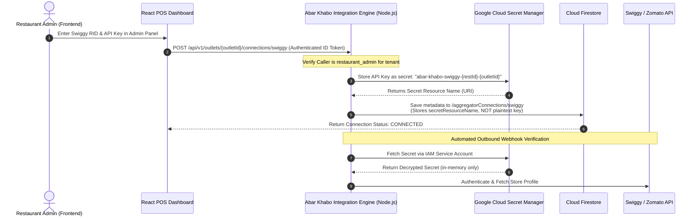
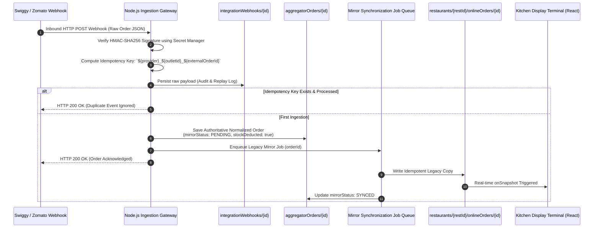
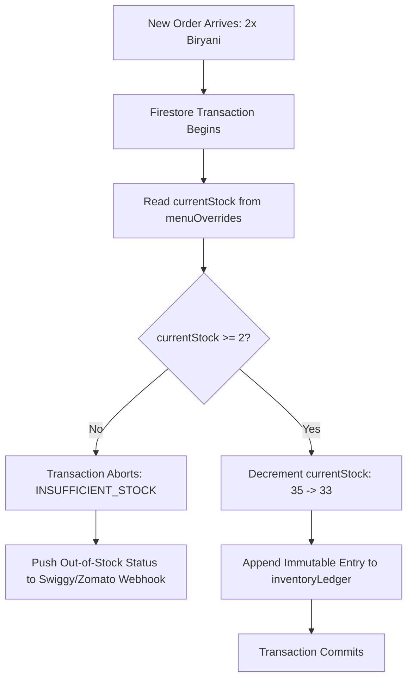
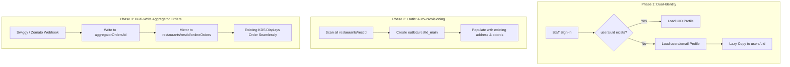

# STAGE 2: DATABASE SCHEMA & OUTLETS MODEL (REVISED)
## Enterprise Multi-Tenant SaaS, Outlet Hierarchy & Aggregator Integration Architecture

**Project:** Abar Khabo  
**System:** Commercial Restaurant POS & Multi-Channel Aggregator Platform  
**Document Status:** Stage 2 Part A — Schema Architecture & Integration Specification (Revised Design)  
**Date:** 2026-11-15  
**Version:** 2.0.0-PROPOSED  

---

## 1. DEFAULT OUTLET IDENTITY & COMPOSITE KEY STRATEGY

### 1.1 Tenant vs. Outlet Identity Separation
In a multi-tenant restaurant SaaS platform, physical and legal boundaries must be strictly distinguished:
* **Tenant (Restaurant Brand / Corporate Entity):** Represented at path `restaurants/{restaurantId}`.
* **Outlet (Physical Store / Branch / Cloud Kitchen):** Represented at path `restaurants/{restaurantId}/outlets/{outletId}`.

### 1.2 The Composite Key Principle
Inside each restaurant's subcollection, the primary outlet document retains a deterministic local ID:
```text
restaurants/{restaurantId}/outlets/{restaurantId}_main
```
> [!IMPORTANT]
> **Deterministic ID Scope:** The string `${restaurantId}_main` is deterministic within a given tenant's subcollection, but **is not globally unique by itself**. Global uniqueness is guaranteed exclusively by:
> 1. **The Full Firestore Document Path:** `restaurants/{restaurantId}/outlets/{outletId}`
> 2. **The Composite Business Key:** `(restaurantId, outletId)`

### 1.3 Collection-Group Query Identification
When querying across all outlets using `collectionGroup('outlets')` or querying orders across all branches:
1. Every outlet document contains both `restaurantId` and `outletId` as explicit top-level string fields.
2. Collection-group queries **must** enforce tenant scoping:
   ```javascript
   // Correctly scoped tenant query across outlets
   const q = query(
     collectionGroup(db, 'outlets'),
     where('restaurantId', '==', activeRestaurantId),
     where('status', '==', 'ACTIVE')
   );
   ```
3. A query omitting `where('restaurantId', '==', ...)` is prohibited by Firestore security rules, preventing any tenant from enumerating another tenant's branches.

---

## 2. AGGREGATOR CREDENTIAL SECURITY & SECRET MANAGEMENT

### 2.1 Separation of Connection Metadata vs. Actual Secrets
Aggregator connections are configured per physical outlet under:
```text
restaurants/{restaurantId}/outlets/{outletId}/aggregatorConnections/{aggregatorId}
```
*(where `aggregatorId` is `swiggy`, `zomato`, or `urbanpiper`)*.

> [!CAUTION]
> **Zero Plaintext Secrets in Firestore:** Actual API keys, merchant passwords, and OAuth tokens **must never** be stored in Firestore documents accessible to the frontend client SDK. Storing encrypted tokens in client-accessible Firestore documents creates an unnecessary attack vector.

### 2.2 Secure Architecture via Google Cloud Secret Manager


### 2.3 Firestore Metadata Document Specification
Path: `restaurants/{restaurantId}/outlets/{outletId}/aggregatorConnections/{aggregatorId}`

```json
{
  "id": "swiggy",
  "restaurantId": "spice-haven",
  "outletId": "spice-haven_main",
  "aggregator": "SWIGGY",
  "merchantStoreId": "548912",
  "authType": "API_KEY",
  "secretReference": {
    "provider": "GOOGLE_SECRET_MANAGER",
    "secretResourceName": "projects/abar-khabo/secrets/swiggy-spice-haven-main/versions/1",
    "lastRotatedAt": "2026-11-15T01:50:00Z"
  },
  "webhookConfig": {
    "webhookUrl": "https://api.abarkhabo.com/api/v1/webhooks/swiggy/order",
    "webhookSecretResourceName": "projects/abar-khabo/secrets/swiggy-whsec-spice-haven-main/versions/1",
    "signatureHeader": "x-swiggy-hmac-sha256"
  },
  "connectionStatus": "CONNECTED",
  "storeStatusOnAggregator": "ONLINE",
  "autoAcceptOrders": false,
  "pricingStrategy": {
    "mode": "EXPLICIT_OVERRIDE_WITH_MULTIPLIER_FALLBACK",
    "defaultMultiplier": 1.15
  },
  "menuSyncEnabled": true,
  "inventorySyncEnabled": true,
  "lastHeartbeatAt": "2026-11-15T02:00:10Z",
  "lastSyncAt": "2026-11-15T01:45:00Z",
  "createdAt": "2026-11-15T01:50:00Z",
  "updatedAt": "2026-11-15T02:00:10Z"
}
```

### 2.4 Credential Rotation and Revocation
* **Scheduled Rotation:** Secrets are versioned in Secret Manager (`versions/1`, `versions/2`). When a merchant rotates keys via Swiggy Partner Portal, the backend writes a new version and updates `secretReference.secretResourceName`.
* **Instant Kill-Switch:** Setting `connectionStatus: 'REVOKED'` immediately causes the integration engine to drop all background polling and reject inbound webhooks with `401 Unauthorized`.

---

## 3. AGGREGATOR ORDER DUAL-MIRRORING ARCHITECTURE

### 3.1 The Authoritative Record Principle
* **Single Source of Truth:** `aggregatorOrders/{orderId}` is the **authoritative document** for all order states, financial figures, customer details, and items.
* **The Legacy Mirror:** `restaurants/{restaurantId}/onlineOrders/{orderId}` and root `onlineOrders/{orderId}` exist **strictly as read-mirrors** so that existing un-migrated React modules (e.g. legacy Kitchen Page, Cashier Terminal) continue displaying orders without immediate code refactoring.

### 3.2 Ingestion & Mirroring Workflow



### 3.3 Preventing Duplicate KOTs, Billing, and Stock Deductions
* **Inventory Deduction:** Bound **exclusively** to the authoritative write in `aggregatorOrders/{orderId}` inside a single Firestore Transaction. The legacy mirror does **not** trigger stock deduction.
* **KOT Generation:** Physical printer tickets and KDS items use `aggregatorOrderId` as their unique deduplication identifier. Even if the legacy mirror sync retries 5 times, KOT generation checks:
  `exists(kotWhere("orderId", "==", aggregatorOrderId))` and aborts duplication.

### 3.4 Authoritative Normalized Order Document
Path: `aggregatorOrders/{orderId}`
Document ID: `SWIGGY_spice-haven_main_1598218902`

```json
{
  "id": "SWIGGY_spice-haven_main_1598218902",
  "idempotencyKey": "SWIGGY_spice-haven_main_1598218902",
  "restaurantId": "spice-haven",
  "outletId": "spice-haven_main",
  "orderSource": "SWIGGY",
  "externalOrderId": "1598218902",
  "channelDisplayId": "SW-8902",
  "orderType": "DELIVERY",
  "orderStatus": "PREPARING",
  "cookingStatus": "COOKING",
  "customer": {
    "name": "Priyanka Sen",
    "phone": "+919830098300",
    "isMasked": true,
    "deliveryAddress": {
      "formatted": "Flat 4B, South City Towers, Kolkata 700068",
      "lat": 22.5023,
      "lng": 88.3614
    }
  },
  "items": [
    {
      "itemId": "dish_biryani_special",
      "name": "Awadhi Mutton Biryani Special",
      "variantName": "Special (2 pcs Mutton)",
      "quantity": 2,
      "unitPrice": 550,
      "totalPrice": 1100,
      "foodType": "NON_VEG",
      "cookingNotes": "Medium spice, extra gravy"
    }
  ],
  "pricing": {
    "itemTotal": 1100,
    "taxes": 55,
    "packagingCharge": 30,
    "deliveryFee": 0,
    "restaurantDiscount": 100,
    "aggregatorDiscount": 50,
    "grandTotal": 1085,
    "commissionRate": 18.0,
    "commissionAmount": 195.3,
    "netPayout": 889.7
  },
  "payment": {
    "method": "SWIGGY_PAY",
    "status": "PAID",
    "transactionId": "TXN_SW_891240182"
  },
  "delivery": {
    "deliveryBy": "SWIGGY_FLEET",
    "riderName": "Suman Das",
    "riderPhone": "+919874512345",
    "riderCoordinates": { "lat": 22.548, "lng": 88.363 },
    "pickupOtp": "4819"
  },
  "mirrorStatus": {
    "legacyOnlineOrders": "SYNCED",
    "subcollectionMirror": "SYNCED",
    "lastSyncedAt": "2026-11-15T01:30:11Z",
    "syncAttempts": 1,
    "lastError": null
  },
  "timestamps": {
    "placedAt": "2026-11-15T01:30:10Z",
    "acceptedAt": "2026-11-15T01:30:45Z",
    "cookingStartedAt": "2026-11-15T01:31:00Z",
    "foodReadyAt": null,
    "deliveredAt": null,
    "cancelledAt": null
  },
  "createdAt": "2026-11-15T01:30:10Z",
  "updatedAt": "2026-11-15T01:31:00Z"
}
```

### 3.5 Legacy Mirror Document
Path: `restaurants/{restaurantId}/onlineOrders/{orderId}` (and root `onlineOrders/{orderId}`)
Document ID: `SWIGGY_spice-haven_main_1598218902`

```json
{
  "id": "SWIGGY_spice-haven_main_1598218902",
  "restaurantId": "spice-haven",
  "outletId": "spice-haven_main",
  "orderSource": "SWIGGY",
  "customerName": "Priyanka Sen (Swiggy #8902)",
  "customerPhone": "+919830098300",
  "deliveryAddress": "Flat 4B, South City Towers, Kolkata 700068",
  "items": [
    {
      "id": "dish_biryani_special",
      "name": "Awadhi Mutton Biryani Special",
      "price": 550,
      "qty": 2
    }
  ],
  "totalAmount": 1085,
  "status": "PREPARING",
  "deliveryStatus": "PLACED",
  "orderType": "DELIVERY",
  "paymentStatus": "PAID",
  "paymentMethod": "SWIGGY_PAY",
  "deliveryFee": 0,
  "notes": "Medium spice, extra gravy",
  "isLegacyMirror": true,
  "authoritativeRef": "aggregatorOrders/SWIGGY_spice-haven_main_1598218902",
  "createdAt": "2026-11-15T01:30:10Z",
  "updatedAt": "2026-11-15T01:31:00Z"
}
```

---

## 4. STAFF IDENTITY & OUTLET AUTHORIZATION MODEL

### 4.1 Transition from `users/{userEmail}` to `users/{uid}`
In the existing codebase, staff profiles are stored under `users/{email}`. 
In the enterprise multi-tenant model:
* Primary identity **must** be keyed by Firebase Authentication UID: `users/{uid}`.
* Avoids problems when staff update their email or when synthetic emails are provisioned.

### 4.2 Explicit Permission Architecture (Eliminating Implicit Access)
> [!WARNING]
> **No Implicit Universal Access:** An omitted or empty `assignedOutletIds` array **must never** automatically grant access to all outlets. Access to all outlets requires an explicit, audited boolean flag: `allOutlets: true`, granted strictly to brand administrators.

### 4.3 Staff Document Specification
Path: `users/{uid}`

```json
{
  "uid": "fb_auth_uid_staff_78912",
  "email": "cashier_pc@spicehaven.com",
  "name": "Sunil Karmakar",
  "phone": "+919876501234",
  "staffIdCode": "482913",
  "authMethod": "staffId",
  "restaurantId": "spice-haven",
  "assignedOutletIds": ["spice-haven_main"],
  "allOutlets": false,
  "role": "cashier",
  "roleScope": "OUTLET_LEVEL",
  "permissions": [
    "pos.orders.read",
    "pos.orders.create",
    "pos.invoices.create",
    "pos.invoices.settle",
    "delivery.riders.assign"
  ],
  "status": "active",
  "emailVerified": true,
  "createdBy": "admin_a_uid",
  "createdAt": "2026-11-15T01:00:00Z",
  "updatedAt": "2026-11-15T01:00:00Z"
}
```

### 4.4 Role Classification Table

| Role | Role Scope | `allOutlets` Allowed? | Permitted Outlets | Primary Capabilities |
| :--- | :---: | :---: | :--- | :--- |
| `super_admin` | PLATFORM | Yes (Global) | All platform tenants & outlets | System administration, tenant onboarding, billing |
| `restaurant_admin` | TENANT | Yes (Tenant) | All outlets under their `restaurantId` | Brand management, menu catalog, outlet onboarding, finance |
| `owner` | TENANT | Yes (Tenant) | All outlets under their `restaurantId` | Full brand ownership, settlement reports |
| `outlet_manager` | OUTLET | **No** | Specific `assignedOutletIds` only | Staff scheduling, daily inventory, local menu overrides |
| `cashier` | OUTLET | **No** | Specific `assignedOutletIds` only | Bill settlement, thermal printing, rider assignment |
| `kitchen` | OUTLET | **No** | Specific `assignedOutletIds` only | KDS order acceptance, cooking updates, food ready |
| `waiter` | OUTLET | **No** | Specific `assignedOutletIds` only | Floor table ordering, KOT generation |

### 4.5 Non-Destructive Backward Compatibility with Legacy `users/{email}`
To maintain 100% backward compatibility with the existing React auth code without downtime:
1. **Dual Lookup Strategy:** The login flow in `AuthContext.jsx` checks:
   - Primary: `doc(db, 'users', fbUser.uid)`
   - Fallback: `doc(db, 'users', fbUser.email.toLowerCase())`
2. **Lazy Migration on Sign-In:** When a user logs in via email:
   If only `users/{email}` exists, the backend/client lazily copies the profile to `users/{uid}` and leaves a lightweight forward reference `{ uid: fbUser.uid }` at `users/{email}`.

---

## 5. MENU PRICING & TRANSACTIONAL INVENTORY ENGINE

### 5.1 Independent Channel Pricing Model
Menu items support distinct pricing across Dine-In, Direct Delivery, Swiggy, and Zomato. We **do not rely exclusively on percentage multipliers**; explicit rupee overrides take absolute precedence.

#### Price Resolution Hierarchy (Order of Precedence):
1. **Explicit Channel Price Override** in `menuOverrides/{itemId}` (e.g. `priceOverrideSwiggy = 550`)
2. **Percentage Adjustment on Base Price** (e.g. `basePrice * (1 + aggregatorConnection.pricingStrategy.defaultMultiplier)`)
3. **Master Base Price** in `menuCatalog/{itemId}` (e.g. `basePrice = 480`)

### 5.2 Menu Override Document Specification
Path: `restaurants/{restaurantId}/outlets/{outletId}/menuOverrides/{itemId}`

```json
{
  "id": "dish_biryani_special",
  "restaurantId": "spice-haven",
  "outletId": "spice-haven_main",
  "channelAvailability": {
    "DINE_IN": true,
    "COUNTER_TAKEAWAY": true,
    "ABAR_KHABO_DIRECT": true,
    "SWIGGY": true,
    "ZOMATO": false
  },
  "channelPricing": {
    "basePrice": 480,
    "dineInPrice": 480,
    "abarKhaboDirectPrice": 480,
    "swiggyPrice": 550,
    "zomatoPrice": 550
  },
  "inventoryTracking": {
    "tracked": true,
    "currentStock": 35,
    "lowStockAlertThreshold": 5,
    "auto86OnZero": true
  },
  "prepTimeMins": 25,
  "updatedAt": "2026-11-15T02:00:00Z"
}
```

### 5.3 Transactional Inventory Operations

All stock adjustments must be executed via **Cloud Firestore Transactions** to guarantee atomicity and prevent race conditions.



### 5.4 Inventory Event Types & Handling

| Event | Trigger | Inventory Action | Ledger Source |
| :--- | :--- | :--- | :--- |
| **Order Placement / Acceptance** | Inbound Swiggy / Zomato / POS order | Deduct quantity atomically | `ORDER_RESERVATION` |
| **Pre-Cooking Cancellation** | Customer cancels within 2 minutes before cooking begins | Re-increment quantity atomically | `CANCELLATION_RESTOCK` |
| **Post-Cooking Cancellation** | Customer cancels after food prepared (`COOKING` or `READY`) | **No restock**; food is wasted | `WASTE_SHRINKAGE` |
| **Physical Stock Count** | Outlet manager counts physical kitchen inventory | Adjusts absolute quantity | `PHYSICAL_AUDIT_ADJUSTMENT` |
| **Supplier Goods Inward** | Vendor purchase order received | Increment quantity | `GOODS_RECEIPT` |

### 5.5 Inventory Ledger Document Specification
Path: `inventoryLedger/{txnId}`
Document ID: `txn_inv_20261115_00491`

```json
{
  "id": "txn_inv_20261115_00491",
  "restaurantId": "spice-haven",
  "outletId": "spice-haven_main",
  "itemId": "dish_biryani_special",
  "itemName": "Awadhi Mutton Biryani Special",
  "previousStock": 35,
  "changeQuantity": -2,
  "newStock": 33,
  "event": "ORDER_RESERVATION",
  "referenceType": "AGGREGATOR_ORDER",
  "referenceId": "SWIGGY_spice-haven_main_1598218902",
  "performedBy": "SYSTEM_TRANSACTION",
  "notes": "Deducted for incoming Swiggy order #1598218902",
  "createdAt": "2026-11-15T01:30:10.500Z"
}
```

---

## 6. COMPLETE INTEGRATION & FINANCIAL DATA MODEL

### 6.1 Webhook Ingestion & Replay Protection
Path: `integrationWebhooks/{webhookId}`
Document ID: `${provider}_${eventId}` (e.g. `SWIGGY_evt_984128490`)

```json
{
  "id": "SWIGGY_evt_984128490",
  "idempotencyKey": "SWIGGY_spice-haven_main_1598218902",
  "provider": "SWIGGY",
  "restaurantId": "spice-haven",
  "outletId": "spice-haven_main",
  "eventType": "ORDER_PLACED",
  "signature": "sha256=9f82ab47c8d9e01f2a3b4c5d6e7f8a9b0c1d2e3f4a5b6c7d8e9f0a1b2c3d4e5f",
  "signatureVerified": true,
  "processingStatus": "PROCESSED",
  "retryCount": 0,
  "processingDurationMs": 38,
  "rawPayload": {
    "order_id": "1598218902",
    "timestamp": 1794709810,
    "store_id": "548912",
    "customer": { "name": "Priyanka Sen", "contact": "+919830098300" },
    "cart": { "items": [{ "id": "dish_biryani_special", "quantity": 2, "price": 550 }] }
  },
  "receivedAt": "2026-11-15T01:30:10.100Z",
  "createdAt": "2026-11-15T01:30:10.100Z"
}
```

### 6.2 Settlement & Reconciliation Specification
Path: `settlementRecords/{settlementId}`
Document ID: `SETTLE_SW_spicehaven_2026_W46`

```json
{
  "id": "SETTLE_SW_spicehaven_2026_W46",
  "restaurantId": "spice-haven",
  "outletId": "spice-haven_main",
  "aggregator": "SWIGGY",
  "periodStartDate": "2026-11-08T00:00:00Z",
  "periodEndDate": "2026-11-14T23:59:59Z",
  "orderCount": 428,
  "financials": {
    "grossItemTotal": 245000,
    "packagingCharges": 6420,
    "deliveryChargesCollected": 0,
    "restaurantDiscounts": 18500,
    "aggregatorDiscounts": 12000,
    "grossBillAmount": 232920,
    "taxDetails": {
      "gstCollected": 11646,
      "tcsGstDeducted": 2329.20,
      "tdsDeducted": 232.92
    },
    "commissionDetails": {
      "commissionRate": 18.0,
      "commissionAmount": 41925.60,
      "gstOnCommission": 7546.60
    },
    "cancellationDeductions": 1250,
    "adjustments": 0,
    "netPayoutAmount": 180781.68
  },
  "payoutStatus": "RECONCILED",
  "paymentReference": {
    "utrNumber": "HDFCR52026111500981",
    "bankName": "HDFC Bank Ltd",
    "accountNumberLast4": "4819",
    "disbursedAt": "2026-11-15T06:00:00Z"
  },
  "createdAt": "2026-11-15T01:00:00Z",
  "updatedAt": "2026-11-15T06:30:00Z"
}
```

### 6.3 Audit Logging Specification
Path: `auditLogs/{logId}`

```json
{
  "id": "audit_891240182",
  "restaurantId": "spice-haven",
  "outletId": "spice-haven_main",
  "actor": {
    "uid": "admin_a_uid",
    "email": "owner@restopulse.com",
    "role": "restaurant_admin"
  },
  "action": "AGGREGATOR_CONNECTION_UPDATED",
  "targetResource": "aggregatorConnections/swiggy",
  "changes": {
    "field": "autoAcceptOrders",
    "oldValue": false,
    "newValue": true
  },
  "ipAddress": "103.21.124.50",
  "userAgent": "Mozilla/5.0 ... Chrome/130.0",
  "timestamp": "2026-11-15T02:00:00Z"
}
```

### 6.4 Background Integration Jobs Specification
Path: `integrationJobs/{jobId}`

```json
{
  "id": "job_sync_legacy_SWIGGY_1598218902",
  "type": "MIRROR_AGGREGATOR_ORDER_TO_LEGACY",
  "restaurantId": "spice-haven",
  "outletId": "spice-haven_main",
  "orderId": "SWIGGY_spice-haven_main_1598218902",
  "status": "COMPLETED",
  "retryCount": 0,
  "maxRetries": 5,
  "backoffFactor": 2,
  "lastError": null,
  "executionTimestamps": {
    "enqueuedAt": "2026-11-15T01:30:10.200Z",
    "startedAt": "2026-11-15T01:30:10.500Z",
    "completedAt": "2026-11-15T01:30:11.100Z"
  }
}
```

---

## 7. SECURITY, QUERY CONSTRAINTS & BACKEND BOUNDARIES

### 7.1 Security & Ownership Matrix

| Collection | Tenant Key | Outlet Key | Document Owner | Permitted Client Operations | Backend-Only Operations |
| :--- | :--- | :--- | :--- | :--- | :--- |
| `restaurants/{restId}` | `id` | N/A | Platform Owner | Public read; Admin update | Creation, deletion, plan changes |
| `.../outlets/{outletId}` | `restaurantId` | `id` | Tenant Admin | Public read; Admin write | Outlet provisioning |
| `.../aggregatorConnections/{id}` | `restaurantId` | `outletId` | Tenant Admin | None (client read metadata only) | Secret fetching, rotation, verification |
| `.../menuCatalog/{itemId}` | `restaurantId` | N/A | Tenant Admin | Public read; Admin write | Bulk catalog imports |
| `.../menuOverrides/{itemId}` | `restaurantId` | `outletId` | Outlet Manager | Public read; Staff toggle | Automated out-of-stock sync |
| `aggregatorOrders/{orderId}` | `restaurantId` | `outletId` | System / Client | Staff read/status update; Rider status | Webhook ingestion, pricing, refunds |
| `integrationWebhooks/{id}` | `restaurantId` | `outletId` | Platform Engine | **None (Forbidden to all clients)** | Ingestion, signature check, replay |
| `inventoryLedger/{txnId}` | `restaurantId` | `outletId` | Platform Engine | Staff read | Transactional stock deduction/restock |
| `settlementRecords/{id}` | `restaurantId` | `outletId` | Tenant Admin | Admin / Owner read | Settlement calculation, bank matching |

### 7.2 Why Specific Query Constraints Are Mandatory
Under Cloud Firestore security rules, **rules cannot act as filters on large sets**. A query must explicitly contain constraints matching the rule condition, or Firestore will reject the entire query:

```javascript
// ❌ FAILS: Missing outletId and restaurantId constraints
const invalidQuery = query(collection(db, 'aggregatorOrders'));

// ✅ SUCCEEDS: Constraints match security rules exactly
const validQuery = query(
  collection(db, 'aggregatorOrders'),
  where('restaurantId', '==', userProfile.restaurantId),
  where('outletId', '==', userProfile.activeOutletId),
  where('orderStatus', '==', 'PREPARING'),
  orderBy('timestamps.placedAt', 'desc')
);
```

---

## 8. STAGED MIGRATION PLAN (ZERO DOWNTIME)



### Staged Rollout Timeline (Pre-requisite to Stage 2 Part B):
1. **Step 1 (Schema Groundwork):** Create composite indexes in `firestore.indexes.json`.
2. **Step 2 (Safe Non-Destructive Script):** Run idempotent migration script that auto-provisions `restaurants/{restId}/outlets/{restId}_main` for any restaurant lacking an outlet.
3. **Step 3 (Dual-Identity Support):** Deploy updated `AuthContext.jsx` with dual UID/Email profile resolution.
4. **Step 4 (Authoritative Order Collection):** Implement server ingestion engine writing to `aggregatorOrders` and mirroring to `onlineOrders`.
5. **Step 5 (UI Outlet Switcher):** Add outlet selection dropdown to React navigation for multi-outlet brand owners.

---

## 9. OUTSTANDING ARCHITECTURAL RISKS & MITIGATIONS

1. **Risk: Aggregator Webhook Flood (DDoS / Burst Volume):**
   * *Mitigation:* Webhook endpoint deployed on Google Cloud Run with an upfront Redis/Cloud Tasks buffer to ingest 1,000+ orders/sec without exceeding Firestore document write rate limits.
2. **Risk: Stale Inventory Overselling on Two Channels Simultaneously:**
   * *Mitigation:* Firestore atomic transactions ensure that if only 1 portion of Biryani remains, the first channel to commit decrements it to 0, immediately triggering an outbound 86 webhook to the second channel.
3. **Risk: Legacy Client Cache Invalidation:**
   * *Mitigation:* Because subcollections are not deleted or moved, legacy client caches continue functioning with zero cache purge errors.
