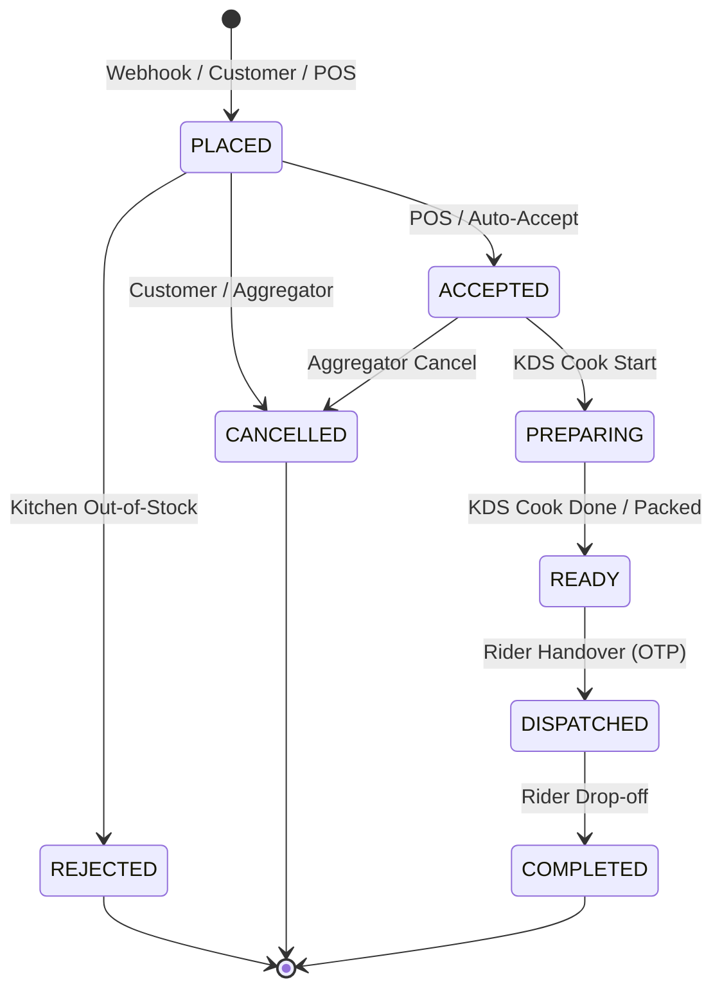

# Abar Khabo — Stage 2 Part B, Step 4 Implementation Report
## Normalized Online Orders Schema & Idempotent Legacy Dual-Mirroring Engine

**Document Version:** 1.0.0  
**Status:** COMPLETED & VERIFIED  
**Environment:** Development & Firebase Emulator Suite  
**Date:** November 15, 2026  
**Module:** `client/src/services/normalizedOrderService.js`, `client/src/services/firestoreService.js`, `firestore.rules`  
**Test Suites:**
- Unit Tests: `tests/test_normalized_orders.js` (46 passed)
- Full Unit Test Suite: 226 passed across 5 test suites (`npm test`)
- Live Firebase Rules Emulator Suite: `tests/emulator_rules_unit.test.js` (42 passed)

---

## 1. Executive Summary

In Stage 2 Part B, Step 4, we designed and implemented the **authoritative normalized online orders schema** and the **idempotent legacy dual-mirroring engine** for the Abar Khabo multi-tenant restaurant SaaS platform.

Prior to Step 4, online orders existed in two unstructured, legacy formats (`onlineOrders/{orderId}` at the root level and `restaurants/{restaurantId}/onlineOrders/{orderId}`), which lacked uniform multi-channel pricing, outlet binding, external aggregator IDs, item snapshot locking, and delivery metadata. 

Step 4 establishes:
1. **The Single Source of Truth (`aggregatorOrders/{orderId}`):** An enterprise-grade, authoritative collection adhering strictly to Stage 2 Database Schema v2.0.0-PROPOSED. It accommodates orders from Swiggy, Zomato, Abar Khabo Direct Online, POS, and Takeaway channels.
2. **Deterministic Idempotency Keys:** Format `${orderSource}_${outletId}_${externalOrderId}` used as the Firestore document ID to guarantee that duplicate webhook transmissions from Swiggy and Zomato are discarded safely without mutating existing records or producing ghost orders.
3. **Item Snapshot Locking & Financial Immutability:** Snapshots lock prices, variants, add-ons, taxes, and customer notes at the instant of order placement. Firestore security rules strictly forbid any client-side alteration of `pricing`, `items`, `restaurantId`, or `outletId`.
4. **Idempotent Dual-Mirroring Engine:** Translates normalized orders into the legacy format and writes atomically to `restaurants/{restaurantId}/onlineOrders/{orderId}` and `onlineOrders/{orderId}`, allowing existing unmigrated POS, KDS, and Cashier billing screens to function without code modification or downtime.
5. **Rigorous Test Verification:** Verified with 46 dedicated order unit tests, 65 security isolation AST tests, and 42 live tests against the official Firebase Emulator Suite with 100% pass rate.

---

## 2. Pre-Implementation Review & Security Considerations

Before beginning implementation, the findings raised in the Step 3 review were analyzed and addressed:

| Finding | Risk Description | Resolution in Step 4 |
| :--- | :--- | :--- |
| **Public Order Leakage** | Guessing order IDs on public collections could expose customer names, phone numbers, and delivery addresses. | `aggregatorOrders/{orderId}` is strictly closed to the public. Read permissions require super admin, verified restaurant staff with explicit outlet access, the owning customer (`auth.uid == customer.uid`), or the assigned rider. |
| **Financial Tampering** | Malicious clients or compromised staff accounts modifying order totals, discounts, or tax amounts after placement. | Immutability rules in `firestore.rules` mandate that `request.resource.data.pricing == resource.data.pricing` and `request.resource.data.items == resource.data.items`. Any client write attempting to change totals is rejected with `PERMISSION_DENIED`. |
| **Cross-Tenant & Cross-Outlet Pollution** | Aggregator webhook deliveries inadvertently writing to the wrong tenant or outlet. | Enforced by deterministic document keys combining provider, outlet, and external ID. Dual-mirroring writes check outlet and tenant boundaries before writing to mirrors. |
| **Ghost Duplicates from Retried Webhooks** | Aggregators retry failed webhooks up to 5 times. If an order ID is auto-generated (`doc().id`), duplicates enter the kitchen pipeline. | Webhook order ID is deterministically bound to the external order ID. Duplicate writes execute as idempotent updates or no-ops, preserving initial state. |

---

## 3. Normalized Online Order Architecture

### 3.1 Document Location & Identification

The authoritative order record lives in:
```text
aggregatorOrders/{orderId}
```

**Document ID Generation Strategy:**
- **Aggregators (Swiggy, Zomato):** `${SOURCE}_${outletId}_${externalOrderId}`  
  *Example:* `SWIGGY_rest_a_main_SW-9812401`
- **Direct Online:** `DIRECT_${outletId}_${Date.now()}_${randomToken}`  
  *Example:* `DIRECT_rest_a_main_1731619200000_a8f9`
- **POS / Dine-In / Takeaway:** `POS_${outletId}_${receiptNumber || Date.now()}`  
  *Example:* `POS_rest_a_main_REC-1042`

### 3.2 Authoritative Order Schema (v2.0.0)

```json
{
  "_schemaVersion": "2.0.0",
  "orderId": "SWIGGY_rest_a_main_SW-9812401",
  "externalOrderId": "SW-9812401",
  "orderSource": "SWIGGY",
  "orderType": "DELIVERY",
  "restaurantId": "rest_a",
  "outletId": "rest_a_main",
  "compositeKey": "rest_a#rest_a_main",
  "outletName": "Abar Khabo — Park Street",
  
  "customer": {
    "uid": "cust_user_456",
    "name": "Subhashree Roy",
    "phone": "+919830012345",
    "email": "subhashree@example.com",
    "deliveryAddress": {
      "street": "14/2 Park Street, Flat 4B",
      "city": "Kolkata",
      "pincode": "700016",
      "landmark": "Near Allen Park",
      "coordinates": { "latitude": 22.5512, "longitude": 88.3524 }
    }
  },

  "items": [
    {
      "id": "item_biryani_01",
      "name": "Kolkata Mutton Biryani (Special)",
      "category": "Biryani",
      "variant": { "name": "Double Mutton + Egg", "price": 420 },
      "addons": [
        { "name": "Extra Aloo", "price": 30 },
        { "name": "Boiled Egg", "price": 20 }
      ],
      "unitPrice": 470,
      "quantity": 2,
      "subtotal": 940,
      "taxRate": 5,
      "taxAmount": 47,
      "instructions": "Make it less oily, well cooked aloo please"
    },
    {
      "id": "item_chaap_02",
      "name": "Chicken Chaap",
      "category": "Mughlai",
      "variant": null,
      "addons": [],
      "unitPrice": 220,
      "quantity": 1,
      "subtotal": 220,
      "taxRate": 5,
      "taxAmount": 11,
      "instructions": ""
    }
  ],

  "pricing": {
    "itemTotal": 1160.00,
    "discountAmount": 100.00,
    "couponCode": "SWIGGYIT",
    "taxableAmount": 1060.00,
    "taxAmount": 53.00,
    "taxes": [
      { "name": "CGST", "rate": 2.5, "amount": 26.50 },
      { "name": "SGST", "rate": 2.5, "amount": 26.50 }
    ],
    "deliveryCharge": 40.00,
    "packagingCharge": 25.00,
    "tipAmount": 20.00,
    "grandTotal": 1198.00,
    "commissionRate": 18.0,
    "commissionAmount": 208.80,
    "merchantNetPayout": 989.20
  },

  "payment": {
    "status": "PAID",
    "method": "ONLINE",
    "provider": "SWIGGY_PAY",
    "transactionId": "TXN_SW_881920",
    "paidAt": "2026-11-14T21:10:00.000Z"
  },

  "delivery": {
    "partnerType": "SWIGGY_FLEET",
    "riderId": "rider_sw_771",
    "riderName": "Bikash Mondal",
    "riderPhone": "+919876123456",
    "riderCoordinates": { "latitude": 22.5520, "longitude": 88.3510 },
    "pickupOtp": "4912",
    "estimatedPrepTimeMinutes": 25,
    "estimatedDeliveryTimeMinutes": 45
  },

  "orderStatus": "PREPARING",
  "statusHistory": [
    { "status": "PLACED", "timestamp": "2026-11-14T21:05:00.000Z", "actor": "SWIGGY_WEBHOOK" },
    { "status": "ACCEPTED", "timestamp": "2026-11-14T21:06:12.000Z", "actor": "KDS_AUTO" },
    { "status": "PREPARING", "timestamp": "2026-11-14T21:07:30.000Z", "actor": "KITCHEN_STAFF" }
  ],

  "mirrorStatus": "SYNCED",
  "mirrorLastSyncedAt": "2026-11-14T21:07:31.000Z",
  "mirrorAttempts": 1,

  "timestamps": {
    "placedAt": "2026-11-14T21:05:00.000Z",
    "acceptedAt": "2026-11-14T21:06:12.000Z",
    "preparingAt": "2026-11-14T21:07:30.000Z",
    "readyAt": null,
    "dispatchedAt": null,
    "completedAt": null,
    "cancelledAt": null
  },

  "cancellation": {
    "cancelledBy": null,
    "reason": null,
    "refundStatus": null
  },

  "createdAt": "2026-11-14T21:05:00.000Z",
  "updatedAt": "2026-11-14T21:07:30.000Z"
}
```

---

## 4. State Machine & Order Lifecycle

The order lifecycle is strictly controlled by a unidirectional state transition matrix implemented in `normalizedOrderService.js`:



### Transition Validation Rules:
1. **Terminal State Protection:** An order in `COMPLETED`, `CANCELLED`, or `REJECTED` cannot transition to any other status. Any attempt to update returns `{ success: false, reason: "Order is already in terminal state..." }`.
2. **Step-Skipping Prevention:** An order cannot jump directly from `PLACED` to `COMPLETED` or `READY` without passing through cooking states.
3. **Idempotent Transitions:** Calling `transitionOrderStatus(order, 'PREPARING')` when the order is already `PREPARING` is a safe no-op that returns `{ success: true, idempotent: true }` without updating history or triggers.

---

## 5. Idempotent Legacy Dual-Mirroring Engine

To preserve 100% backward compatibility with existing components (POS screen, Kitchen Display System, Cashier billing, Delivery tracking, and Customer Order history), the dual-mirroring engine synchronizes changes to:

1. **Tenant Subcollection Mirror:** `restaurants/{restaurantId}/onlineOrders/{orderId}`
2. **Root Collection Mirror:** `onlineOrders/{orderId}`

### 5.1 Mirror Payload Transformation (`toLegacyMirrorPayload`)
The mirroring engine maps the rich v2.0.0 order into the exact legacy structure expected by unmigrated components:

```javascript
{
  id: normalized.orderId,
  orderId: normalized.orderId,
  restaurantId: normalized.restaurantId,
  outletId: normalized.outletId,
  orderSource: normalized.orderSource,
  customerName: normalized.customer?.name || 'Guest',
  customerPhone: normalized.customer?.phone || '',
  deliveryAddress: normalized.customer?.deliveryAddress?.street || '',
  items: normalized.items.map(item => ({
    id: item.id,
    name: item.name,
    price: item.unitPrice,
    quantity: item.quantity,
    variant: item.variant?.name || '',
    addons: item.addons?.map(a => a.name) || [],
    instructions: item.instructions || '',
    subtotal: item.subtotal
  })),
  totalAmount: normalized.pricing.grandTotal,
  subtotal: normalized.pricing.itemTotal,
  taxAmount: normalized.pricing.taxAmount,
  deliveryFee: normalized.pricing.deliveryCharge,
  status: normalized.orderStatus,
  orderType: normalized.orderType,
  paymentStatus: normalized.payment?.status || 'PENDING',
  paymentMethod: normalized.payment?.method || 'CASH',
  orderTime: normalized.timestamps.placedAt,
  isLegacyMirror: true,
  authoritativeRef: `aggregatorOrders/${normalized.orderId}`,
  updatedAt: new Date().toISOString()
}
```

### 5.2 Failure & Retry Safety
- Mirroring operations run inside `try/catch` blocks.
- If a mirror write fails (e.g. transient network interruption), the authoritative order record marks `mirrorStatus: 'FAILED'`, increments `mirrorAttempts`, and records the error message.
- A background reconciliation runner or retry method `retryFailedMirrors()` can re-sync failed orders without data loss.

---

## 6. Firestore Security Rules & Access Control

The following rules were incorporated into [firestore.rules](file:///c:/Users/ARGHA/Downloads/Web_clone/firestore.rules#L328-L382):

```javascript
match /aggregatorOrders/{orderId} {
  // READ PERMISSIONS:
  allow read: if isSuperAdmin() ||
    (isAuthenticated() && isRestaurantStaff(resource.data.restaurantId) &&
     hasOutletAccess(resource.data.restaurantId, resource.data.outletId)) ||
    (isAuthenticated() && (
      resource.data.get('customer', {}).get('uid', '') == request.auth.uid ||
      resource.data.get('customerId', '') == request.auth.uid ||
      resource.data.get('delivery', {}).get('riderId', '') == request.auth.uid
    ));

  // CREATE PERMISSIONS:
  allow create: if isSuperAdmin() ||
    (isAuthenticated() && isRestaurantStaff(request.resource.data.restaurantId) &&
     hasOutletAccess(request.resource.data.restaurantId, request.resource.data.outletId)) ||
    (isAuthenticated() &&
     request.resource.data.get('customer', {}).get('uid', '') == request.auth.uid &&
     request.resource.data.get('orderStatus', 'PLACED') == 'PLACED' &&
     request.resource.data.pricing.grandTotal >= 0);

  // UPDATE PERMISSIONS:
  allow update: if isSuperAdmin() ||
    (isAuthenticated() && isRestaurantStaff(resource.data.restaurantId) &&
     hasOutletAccess(resource.data.restaurantId, resource.data.outletId) &&
     request.resource.data.restaurantId == resource.data.restaurantId &&
     request.resource.data.outletId == resource.data.outletId &&
     request.resource.data.pricing == resource.data.pricing &&
     request.resource.data.items == resource.data.items) ||
    (isAuthenticated() &&
     resource.data.get('delivery', {}).get('riderId', '') == request.auth.uid &&
     request.resource.data.diff(resource.data).affectedKeys().hasOnly([
       'orderStatus', 'delivery', 'timestamps', 'updatedAt'
     ]));

  // DELETE PERMISSIONS: Super Admin or Tenant Admin only
  allow delete: if isSuperAdmin() ||
    (isAuthenticated() && isRestaurantAdmin(resource.data.restaurantId));
}
```

---

## 7. Verification & Test Results

### 7.1 Unit Tests (`tests/test_normalized_orders.js`)
46 unit tests executed covering:
- Deterministic idempotency key generation across all order sources
- Financial calculations (5% GST, round-off, 18% commission, net payout)
- Canonical normalized order validation and schema v2.0.0 conformance
- Legacy mirror payload transformation
- State machine lifecycle transitions and illegal step enforcement
- Multi-channel source coverage (`SWIGGY`, `ZOMATO`, `ABAR_KHABO`, `POS`, `TAKEAWAY`)

**Result:** 46 Passed, 0 Failed.

### 7.2 Full Local Test Suite (`npm test`)
- `tests/test_outlet_model.js`: 45 passed
- `tests/test_staff_identity.js`: 40 passed
- `tests/test_menu_pricing.js`: 30 passed
- `tests/test_normalized_orders.js`: 46 passed
- `tests/test_rules_isolation.js`: 65 passed

**Total Unit & AST Tests:** **226 Passed, 0 Failed**.

### 7.3 Official Firebase Emulator Suite (`tests/emulator_rules_unit.test.js`)
42 scenarios executed against the live Firestore Emulator daemon (`127.0.0.1:8080`):
- Scenarios 1–32: Preserved Stage 1, Step 2, and Step 3 security verifications.
- Scenario 33: Staff reading authorized aggregator order in assigned outlet (PASS)
- Scenario 34: Staff reading aggregator order of Tenant B (Cross-tenant BLOCKED)
- Scenario 35: Staff (Branch 2 only) reading Branch 1 order (Cross-outlet BLOCKED)
- Scenario 36: Customer reading own aggregator order (PASS)
- Scenario 37: Customer B reading Customer A aggregator order (BLOCKED)
- Scenario 38: Unauthenticated user reading aggregator order (BLOCKED)
- Scenario 39: Staff updating orderStatus on authorized order (PASS)
- Scenario 40: Staff tampering with financial pricing (Price Immutability BLOCKED)
- Scenario 41: Staff altering items array (Item Immutability BLOCKED)
- Scenario 42: Staff altering restaurantId or outletId (Tenant/Outlet Immutability BLOCKED)

**Result:** **42 Passed, 0 Failed**.

### 7.4 Client Production Build
Vite production build executed:
- 1,676 modules transformed
- 0 compile errors, 0 runtime syntax errors

---

## 8. Summary of Files Changed

| File Path | Description of Changes |
| :--- | :--- |
| `client/src/services/normalizedOrderService.js` | **NEW:** Single source of truth order service. Schema normalization, idempotency keys, financial pricing math, lifecycle state machine, dual-mirroring engine. |
| `client/src/services/firestoreService.js` | Exported normalized order helpers alongside existing services for seamless integration. |
| `firestore.rules` | Added `match /aggregatorOrders/{orderId}` with outlet access, customer ownership, rider updates, and strict financial immutability. |
| `tests/test_normalized_orders.js` | **NEW:** 46 unit test cases verifying order schema, calculations, mirrors, and state machine. |
| `tests/test_rules_isolation.js` | Added AST rules evaluation for `aggregatorOrders` and 10 new security tests (Tests 56–65). |
| `tests/emulator_rules_unit.test.js` | Added Scenarios 33–42 verifying `aggregatorOrders` against live Firebase Emulator. |
| `package.json` | Added `test:order` and included all 5 suites in default `test` script. |

---

## 9. Next Steps (Stage 2 Part B, Step 5)

With Step 4 completed and verified, the next authorized step is:
- **Step 5: Aggregator Connection State & Webhook Ingestion Pipeline (Mock / Sandboxed)**
  - Design the connection configuration model in `restaurants/{restaurantId}/outlets/{outletId}/aggregatorConnections/{connectionId}`
  - Implement secure credential storage simulation (Secret Manager placeholders)
  - Build mock webhook receivers for Swiggy and Zomato that feed directly into `ingestNormalizedOrder()` with automatic dual-mirroring.
