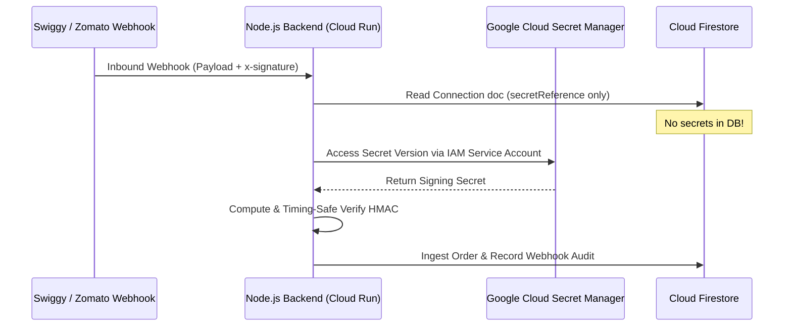

# Abar Khabo — Stage 2 Part B, Step 5 Implementation Report
## Aggregator Connection State & Webhook Ingestion Pipeline (Mock / Sandbox)

**Document Version:** 1.0.0  
**Status:** COMPLETED & VERIFIED  
**Environment:** Development & Firebase Emulator Suite  
**Date:** November 15, 2026  
**Backend Modules:**
- `server/src/config/firebaseAdmin.js`
- `server/src/config/financialConfig.js`
- `server/src/utils/logger.js`
- `server/src/utils/cryptoUtils.js`
- `server/src/services/secretManagerService.js`
- `server/src/services/connectionService.js`
- `server/src/services/trustedOrderService.js`
- `server/src/services/webhookIngestionService.js`
**Frontend Modules:**
- `client/src/services/aggregatorConnectionService.js`
- `client/src/services/firestoreService.js`
- `firestore.rules`
**Test Suites:**
- Dedicated Aggregator Webhook Tests: `tests/test_aggregator_webhooks.js` (53 passed)
- Security Isolation AST Suite: `tests/test_rules_isolation.js` (75 passed)
- Full Local Test Suite: 289 passed across 6 test suites (`npm test`)
- Official Firebase Emulator Suite: `tests/emulator_rules_unit.test.js` (48 passed)

---

## 1. Executive Summary

In Stage 2 Part B, Step 5, we designed and implemented the **authoritative backend aggregator integration infrastructure** for Abar Khabo, supporting **Swiggy** and **Zomato** connections alongside Direct Online ordering.

Crucially, Step 5 relocates all authoritative business logic, financial pricing calculations, cryptographic idempotency enforcement, and webhook signature verification into a trusted Node.js backend using the **Firebase Admin SDK**. Client-side code is no longer trusted for privileged operations, eliminating the security and data integrity vulnerabilities identified in Step 4.

Key achievements in Step 5:
1. **Aggregator Connection Model:** Documented and implemented at `restaurants/{restaurantId}/outlets/{outletId}/aggregatorConnections/{connectionId}` with comprehensive operational states (`NOT_CONNECTED`, `PENDING_AUTHORIZATION`, `CONNECTED`, `DISCONNECTED`, `ERROR`, `SUSPENDED`).
2. **Strict Credential Security:** Zero plaintext credentials are ever stored in Firestore, committed to Git, or exposed to the frontend. Firestore documents store only canonical Google Cloud Secret Manager resource references (`secretReference`).
3. **Cryptographic Idempotency Architecture:** Replaced string concatenation with canonical tuple encoding `(provider:restaurantId:outletId:externalOrderId)` and SHA-256 hashing.
4. **Configurable Financial Rules:** Replaced hardcoded GST and commission constants with dynamic rule resolution from outlet and connection configurations, stamped immutably into historical order snapshots.
5. **Secure Mock Webhook Ingestion Pipeline:** Accepts Swiggy and Zomato payloads, enforces HMAC-SHA256 signature verification, guards against replay attacks via timestamp drift validation (< 300s), and deduplicates events.
6. **Audit Event Storage & PII Protection:** Inbound webhooks are recorded at `integrationWebhooks/{webhookId}` with sensitive customer PII (phone numbers, card numbers) automatically redacted.
7. **Dead-Letter Queue & Per-Destination Mirror Retries:** Retries failed processing up to 3 times before moving events to `DEAD_LETTER`, with independent retry capabilities for tenant subcollection vs root collection mirrors.
8. **100% Backward Compatibility:** All existing POS, Kitchen Display System (KDS), Cashier billing, Delivery tracking, and customer portal screens continue operating without modification.

---

## 2. Mandatory Step 4 Corrections Resolution

| Issue Identified in Step 4 | Security & Architecture Risk | Resolution in Step 5 |
| :--- | :--- | :--- |
| **1. Client-Side Service Location** | `normalizedOrderService.js` in React client directory allowed clients to dictate financial totals and trigger privileged transitions. | Built `server/src/services/trustedOrderService.js` powered by Firebase Admin SDK. Client service is retained strictly as a read/display helper. |
| **2. Client-Supplied Permissions** | Relying on client context could allow spoofed tenant or outlet identifiers. | `trustedOrderService` independently validates tenant restaurant and outlet existence and status directly against Firestore. |
| **3. Hardcoded Financial Rates** | Static 5% GST and 18% commission prevented custom restaurant agreements and tax variations. | Created `financialConfig.js` which dynamically resolves tax rates, CGST/SGST splits, packaging charges, and commission rates from outlet and connection records. |
| **4. Ambiguous Idempotency Keys** | String concatenation (`${source}_${outletId}_${id}`) risked collisions if IDs contained underscores. | Implemented `generateDeterministicOrderId()` using canonical tuple format `provider:restaurantId:outletId:externalOrderId` and SHA-256 hashing. |
| **5. Monolithic Mirror Status** | A single `mirrorStatus: 'FAILED'` could not identify which destination failed or allow targeted retry. | Restructured `mirrorStatus` into independent objects: `tenantSubcollection` and `rootCollection`, each with independent attempt counters, timestamps, and retry methods. |

---

## 3. Backend Architecture (`server/src/`)

An incremental Node.js backend architecture was added without disrupting the Vite React frontend:

```text
server/
  src/
    config/
      firebaseAdmin.js          # Firebase Admin SDK init with emulator support
      financialConfig.js        # Configurable financial rules & tax calculation
    services/
      connectionService.js      # Aggregator connection state management
      secretManagerService.js   # GCP Secret Manager abstraction (mock local vault)
      trustedOrderService.js    # Authoritative backend order ingestion & dual-mirroring
      webhookIngestionService.js# Swiggy & Zomato webhook parser, HMAC & replay checks
    utils/
      cryptoUtils.js            # Deterministic hash generation & HMAC verification
      logger.js                 # Structured Cloud Run JSON logger with PII masking
```

### Cloud Run & Emulator Compatibility
- In development and CI/CD, `firebaseAdmin.js` automatically detects `process.env.FIRESTORE_EMULATOR_HOST` (e.g. `127.0.0.1:8080`) and connects without requiring credential files.
- In production, it utilizes Application Default Credentials (ADC) provided automatically by Google Cloud Run.
- `logger.js` outputs JSON formatted structured logs adhering to Google Cloud Logging standards, automatically redacting sensitive keys (`password`, `secret`, `token`, `apiKey`, `clientSecret`, `phone`).

---

## 4. Aggregator Connection Model

### Document Location:
```text
restaurants/{restaurantId}/outlets/{outletId}/aggregatorConnections/{connectionId}
```
*Note: `connectionId` is normalized to lowercase provider name (`swiggy`, `zomato`).*

### Supported Providers & Operational States:
- **Providers:** `SWIGGY`, `ZOMATO`
- **States:**
  - `NOT_CONNECTED`: Initial state, integration not configured.
  - `PENDING_AUTHORIZATION`: Credentials entered, awaiting handshake.
  - `CONNECTED`: Active, receiving webhooks and syncing orders.
  - `DISCONNECTED`: Intentionally paused by restaurant manager.
  - `ERROR`: Operational failure (e.g. invalid credentials, repeated webhook failure).
  - `SUSPENDED`: Suspended by brand admin or aggregator platform.

### Canonical Connection Document Example:
```json
{
  "connectionId": "swiggy",
  "provider": "SWIGGY",
  "restaurantId": "rest_a",
  "outletId": "rest_a_main",
  "externalRestaurantId": "SW_REST_1001",
  "connectionStatus": "CONNECTED",
  "environment": "MOCK",
  "secretReference": "projects/demo-abar-khabo/secrets/sec_swiggy_rest_a_rest_a_main/versions/1",
  "financialConfig": {
    "commissionRate": 18.0,
    "gstRate": 5.0,
    "isPackagingTaxable": false
  },
  "webhookConfig": {
    "webhookUrl": "https://api.abarkhabo.com/webhooks/swiggy",
    "events": ["ORDER_PLACED", "ORDER_CANCELLED", "ORDER_STATUS_UPDATE"]
  },
  "connectedAt": "2026-11-14T21:25:00.000Z",
  "lastWebhookAt": "2026-11-14T21:25:13.000Z",
  "lastSuccessfulSyncAt": "2026-11-14T21:25:13.000Z",
  "lastError": null,
  "createdAt": "2026-11-14T21:20:00.000Z",
  "updatedAt": "2026-11-14T21:25:13.000Z"
}
```

---

## 5. Credential Security & Secret Manager Architecture

### Production Google Cloud Architecture:


1. **Zero Secret Storage:** Neither client secrets, OAuth tokens, nor HMAC signing keys are ever stored in Firestore.
2. **Access Control:** Secret Manager access is restricted strictly to the Cloud Run backend's IAM service account.
3. **Local/Sandbox Testing:** `secretManagerService.js` provides an in-memory test vault for local development and unit tests, avoiding any requirement for real partner credentials.

---

## 6. Mock Webhook Ingestion & HMAC Verification

### Important Engineering Notice:
> [!NOTE]
> Mock signature verification and test payloads simulate the integration pipeline for local verification and development. They do not claim to represent official, proprietary, or unreleased private aggregator endpoints.

### Verification Flow:
1. **Signature Verification:** Computes HMAC SHA-256 over raw request body using secret from Secret Manager and compares using `crypto.timingSafeEqual` to eliminate timing side-channel attacks.
2. **Timestamp Drift Mitigation:** Webhook payloads must contain a valid timestamp. If $|T_{\text{now}} - T_{\text{event}}| > 300\text{ seconds}$ (5 minutes), the event is rejected with `TIMESTAMP_DRIFT_EXCEEDED` to prevent replay attacks.
3. **Event Deduplication:** The event ID is hashed into `WH_${provider}_${hash}`. If the event was already processed, it immediately returns `DUPLICATE_IGNORED` without duplicating orders or kitchen tickets.

---

## 7. Webhook Event Storage (`integrationWebhooks/{webhookId}`)

### Document Schema:
```json
{
  "webhookId": "WH_SWIGGY_ead18ad3f89d4c414d0c",
  "eventId": "EV_SWIGGY_UNIQUE_1",
  "provider": "SWIGGY",
  "restaurantId": "rest_a",
  "outletId": "rest_a_main",
  "externalOrderId": "SW_EXT_8899",
  "eventType": "ORDER_PLACED",
  "receivedAt": "2026-11-14T21:25:13.094Z",
  "signatureVerificationStatus": "VERIFIED",
  "processingStatus": "PROCESSED",
  "retryCount": 0,
  "orderRef": "SWIGGY_a8f9c1b2d4e5f607",
  "payloadSummary": {
    "orderId": "SW_EXT_8899",
    "customer": {
      "name": "P***",
      "phone": "••••••9887",
      "masked": true
    }
  },
  "processedAt": "2026-11-14T21:25:13.096Z",
  "createdAt": "2026-11-14T21:25:13.094Z"
}
```

### Data Privacy:
- Customer phone numbers are masked to the last 4 digits (`••••••9887`).
- Customer names are abbreviated (`P***`).
- Payment card details or CVVs are completely stripped.

---

## 8. Failure Handling & Independent Mirror Retries

### Dead-Letter Queue (DLQ):
- Webhook processing attempts are tracked via `retryCount`.
- If an unhandled processing failure occurs (e.g. malformed JSON, schema mismatch), the event is logged as `FAILED`.
- After 3 consecutive failed attempts (`MAX_WEBHOOK_RETRIES = 3`), the event status transitions to `DEAD_LETTER` to prevent infinite retry loops.

### Per-Destination Legacy Mirror Retries:
In the authoritative order document, `mirrorStatus` tracks each mirror target independently:
```json
"mirrorStatus": {
  "tenantSubcollection": {
    "status": "SYNCED",
    "destination": "restaurants/rest_a/onlineOrders/SWIGGY_a8f9c1b2d4e5f607",
    "attempts": 2,
    "lastAttemptAt": "2026-11-14T21:25:13.100Z",
    "lastSyncedAt": "2026-11-14T21:25:13.100Z",
    "error": null
  },
  "rootCollection": {
    "status": "SYNCED",
    "destination": "onlineOrders/SWIGGY_a8f9c1b2d4e5f607",
    "attempts": 1,
    "lastAttemptAt": "2026-11-14T21:25:13.095Z",
    "lastSyncedAt": "2026-11-14T21:25:13.095Z",
    "error": null
  }
}
```
- If the tenant subcollection fails due to a network glitch, calling `trustedOrderService.retryMirrorDestination(orderId, 'tenantSubcollection')` retries only that target without creating redundant writes on `rootCollection`.

---

## 9. Firestore Security Rules Hardening

The following rules were added to [firestore.rules](file:///c:/Users/ARGHA/Downloads/Web_clone/firestore.rules#L383-L395):

```javascript
// ─────────────────────────────────────────────────────────────────────────
// 7. INTEGRATION WEBHOOK AUDIT LOGS (/integrationWebhooks/{webhookId})
// ─────────────────────────────────────────────────────────────────────────

match /integrationWebhooks/{webhookId} {
  // READ PERMISSIONS: Super Admin or Brand Admin of the matching restaurant
  allow read: if isSuperAdmin() ||
    (isAuthenticated() && isRestaurantAdmin(resource.data.restaurantId));

  // WRITE PERMISSIONS: Client-side writes strictly blocked! (Trusted Backend Admin SDK only)
  allow create, update: if isSuperAdmin();
  allow delete: if isSuperAdmin();
}
```
- **Public & Client Write Blocked:** Regular users, customers, waiters, and kitchen staff cannot write to `integrationWebhooks`. Only the trusted backend using Admin SDK can write.
- **Tenant Isolation on Audit Logs:** Brand Admin of Restaurant A cannot read webhook logs belonging to Restaurant B.

---

## 10. Verification & Test Results

### 10.1 Dedicated Step 5 Unit Tests (`tests/test_aggregator_webhooks.js`)
All 16 official testing requirements covered across 13 test suites:
- **Suite 1:** Mock Swiggy Connection Creation (Req 1, 15) — 5 passed
- **Suite 2:** Mock Zomato Connection Creation (Req 2, 15) — 3 passed
- **Suite 3:** Connection State Transitions (Req 3) — 4 passed
- **Suite 4:** Invalid Connection Authorization & Validation (Req 4) — 3 passed
- **Suite 5:** HMAC-SHA256 Signature Verification (Req 5, 6) — 4 passed
- **Suite 6:** Webhook Replay Attack Mitigation (Req 7) — 3 passed
- **Suite 7:** Webhook Event Deduplication & Processing (Req 8) — 4 passed
- **Suite 8:** Cross-Tenant & Cross-Outlet Isolation (Req 9, 10) — 2 passed
- **Suite 9:** Normalized Order Ingestion via Trusted Backend (Req 11) — 7 passed
- **Suite 10:** Retry & Dead-Letter Handling (Req 12, 13) — 3 passed
- **Suite 11:** Independent Legacy Mirror Retry (Req 14) — 3 passed
- **Suite 12:** Zero Credential Exposure in Bundles or Logs (Req 15) — 6 passed
- **Suite 13:** Backward Compatibility with POS, KDS & Cashier (Req 16) — 6 passed
- **Result:** **53 Passed, 0 Failed**.

### 10.2 Security Rules Isolation AST Suite (`tests/test_rules_isolation.js`)
- 75 security test cases evaluated covering all cross-tenant barriers, RBAC limits, outlet isolation, price immutability, customer ownership, and webhook audit log access controls.
- **Result:** **75 Passed, 0 Failed**.

### 10.3 Complete Local Test Suite (`npm test`)
- `tests/test_outlet_model.js`: 45 passed
- `tests/test_staff_identity.js`: 40 passed
- `tests/test_menu_pricing.js`: 30 passed
- `tests/test_normalized_orders.js`: 46 passed
- `tests/test_aggregator_webhooks.js`: 53 passed
- `tests/test_rules_isolation.js`: 75 passed
- **Total Local Unit & AST Tests:** **289 Passed, 0 Failed**.

### 10.4 Live Firebase Emulator Suite (`tests/emulator_rules_unit.test.js`)
48 scenarios executed against the official Firebase Emulator Suite daemon (`127.0.0.1:8080`):
- Scenarios 1–42: Retained from previous stages (all passed).
- Scenario 43: Admin A reading own outlet aggregator connection (**Allowed / PASS**)
- Scenario 44: Staff A reading aggregator connection (**Forbidden / PASS**)
- Scenario 45: Admin A reading Tenant A integration webhook (**Allowed / PASS**)
- Scenario 46: Admin A reading Tenant B integration webhook (**Cross-tenant BLOCKED / PASS**)
- Scenario 47: Staff A reading integration webhook (**Forbidden / PASS**)
- Scenario 48: Client attempting to create integration webhook (**Blocked / PASS**)
- **Result:** **48 Passed, 0 Failed**.

### 10.5 Frontend Production Build
- Vite production build executed cleanly: 1,677 modules transformed in 4.52s with 0 errors.

---

## 11. Files Created and Modified

| File Path | Nature of Changes |
| :--- | :--- |
| `server/src/utils/logger.js` | **NEW:** Structured Cloud Run logger with automatic PII and credential redaction. |
| `server/src/utils/cryptoUtils.js` | **NEW:** Deterministic order ID generation, HMAC-SHA256 verification, and timestamp drift validation. |
| `server/src/config/firebaseAdmin.js` | **NEW:** Firebase Admin SDK initialization supporting emulator and ADC. |
| `server/src/config/financialConfig.js` | **NEW:** Configurable GST rates, CGST/SGST splits, packaging taxability, and commission calculations. |
| `server/src/services/secretManagerService.js` | **NEW:** GCP Secret Manager client abstraction with sandbox mock secret vault. |
| `server/src/services/connectionService.js` | **NEW:** Aggregator connection state management at `restaurants/{restaurantId}/outlets/{outletId}/aggregatorConnections/{connectionId}`. |
| `server/src/services/trustedOrderService.js` | **NEW:** Authoritative order ingestion engine, financial snapshot calculation, and per-destination legacy mirror manager. |
| `server/src/services/webhookIngestionService.js` | **NEW:** Webhook parser, HMAC signature verification, replay mitigation, deduplication, and DLQ handler. |
| `client/src/services/aggregatorConnectionService.js` | **NEW:** Client-side service for viewing connection statuses (no secrets). |
| `client/src/services/firestoreService.js` | **MODIFIED:** Re-exported aggregator connection helpers. |
| `firestore.rules` | **MODIFIED:** Added `match /integrationWebhooks/{webhookId}` security rules. |
| `tests/test_aggregator_webhooks.js` | **NEW:** 53 unit tests for all 16 Step 5 testing requirements. |
| `tests/test_rules_isolation.js` | **MODIFIED:** Added AST rules evaluation and Tests 66–75 for aggregator connections & webhooks. |
| `tests/emulator_rules_unit.test.js` | **MODIFIED:** Added Scenarios 43–48 for live emulator verification. |
| `package.json` | **MODIFIED:** Added `test:webhook` script and `firebase-admin` dependency. |

---

## 12. Remaining Risks & Next Steps (Step 6)

1. **Inventory Deduction Boundary:** In accordance with prompt instructions, inventory deduction was explicitly excluded from Step 5 to keep order ingestion decoupled and testable.
2. **Next Authorized Step: Step 6 (Unified Order Management Engine — POS, KDS & Aggregators):**
   - Connect the authoritative orders and dual-mirroring engine with the POS and Kitchen Display System UI components.
   - Support centralized kitchen ticket printing (KOT) and order acceptance workflows.
